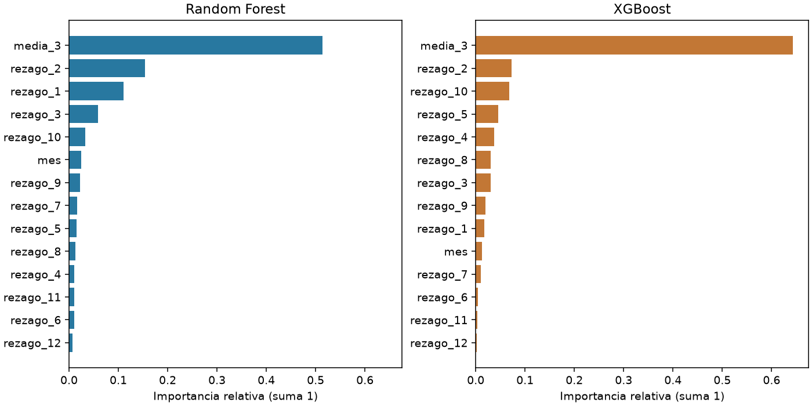
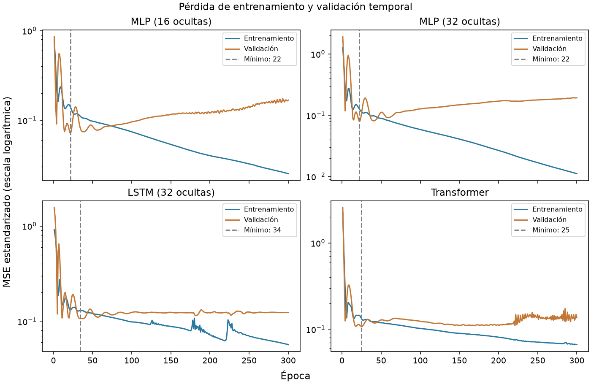
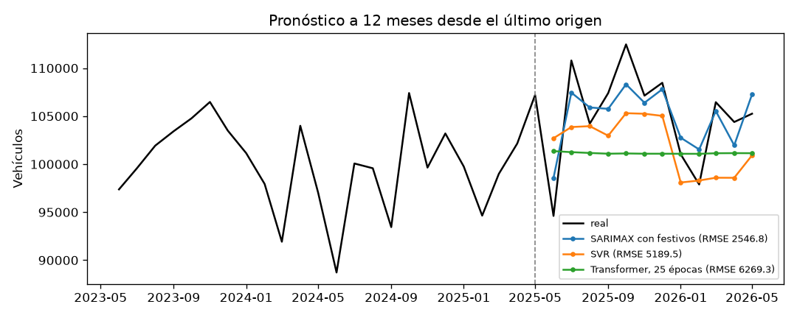

# Informe del miniproyecto 2

Se retoma la serie mensual de tráfico del peaje Siberia y su mejor modelo
clásico, el SARIMAX con festivos del miniproyecto 1, para enfrentarlo con
cuatro modelos de aprendizaje automático y tres redes neuronales. Todas las
cifras provienen de lo que imprime `python miniproyecto.py` en CPU y de las
tablas `resultados/metricas.csv` y `resultados/semillas.csv`; las figuras
son las que el guion deja en `figuras/`. RMSE y MAE se expresan en
vehículos y MAPE en porcentaje.

## 1. La serie y el modelo a superar

La serie mide el **número mensual de vehículos de las categorías
tarifarias III a VII que pasan por el peaje Siberia** (corredor
Bogotá–Medellín), según el conjunto *Tráfico Vehicular ANI* de Datos
Abiertos Colombia. Cubre de **enero de 2014 a mayo de 2026, con 149
observaciones** y ningún mes vacío. Se mantiene la decisión del
miniproyecto 1: no hay huecos que imputar y el criterio
$1{,}5\times IQR$ ($Q_1=75\,367$, $Q_3=101\,146$, límites
$[36\,698{,}5;\ 139\,814{,}5]$) no marca ningún atípico, de modo que
`preparar` conserva los valores originales. Esto incluye la caída de abril
de 2020 (68.302 vehículos), que queda dentro de los límites y se trata como
parte de la historia de la serie.


La línea punteada marca junio de 2024, el primer mes que se pronostica en
el *backtest*: los 13 orígenes van de mayo de 2024 a mayo de 2025 y cada
uno pronostica 12 meses. La figura muestra lo que cualquier modelo debe
capturar: una tendencia creciente con un salto de nivel entre 2020 y 2021,
un patrón anual con caídas en febrero y junio, y un tramo de prueba en el
que la serie alcanza máximos que nunca había tenido.

El modelo a superar es el **SARIMAX(0,1,1)(1,0,1)_{12} con el conteo
mensual de festivos** como variable exógena. Con $z_t=y_t/10\,000$, $x_t$
el número de festivos del mes y $B$ el operador de rezago, es una regresión
con errores SARIMA:

$$
z_t=\beta x_t+u_t, \qquad
(1-\Phi_1B^{12})(1-B)u_t=(1+\theta_1B)(1+\Theta_1B^{12})\varepsilon_t .
$$

Los órdenes son fijos y los coeficientes se vuelven a estimar en cada
origen. En el último origen (mayo de 2025) quedaron $\theta_1=-0{,}5749$,
$\Phi_1=0{,}9993$, $\Theta_1=-0{,}9589$ y $\hat\sigma^2=0{,}1188$; el
coeficiente de festivos fue $\beta=-0{,}2309$, es decir, **−2.308,82
vehículos por cada festivo adicional en el mes**. Junto con $\sigma^2$,
son los 5 parámetros que cuenta la tabla.

En el *backtest* común obtiene **RMSE de 4.131,63, MAE de 3.466,94 y MAPE
de 3,33 %**. El miniproyecto 1 había reportado 4.137,53, 3.471,17 y
3,34 %. La especificación no cambió: son los mismos datos, órdenes,
escala, optimizador (L-BFGS con hasta 200 iteraciones) y calendario. Lo
único distinto es de dónde sale el calendario: como `holidays` no está
entre las bibliotecas permitidas, los festivos se leen ahora de
`datos/festivos_colombia.csv`. Se comprobó que sus 161 valores (enero de
2014 a mayo de 2027) son idénticos a los que generaba `holidays` 0.107.
Además, al correr hoy el propio guion del miniproyecto 1 se obtiene también
4.131,63. La diferencia de 5,90 vehículos (0,14 % del RMSE) viene, por lo
tanto, de la ejecución anterior: es numérica, del punto en que se detiene
el optimizador, y no altera ninguna conclusión. Por la misma razón, el
coeficiente de festivos del último origen pasa de −2.306,51 a −2.308,82.

## 2. La tabla supervisada

Para que los modelos de aprendizaje automático y las redes trabajen con
la serie, cada mes $t$ se convierte en una fila con **14 predictores**,
todos calculados con información anterior a $t$:

| Columna | Fórmula | Qué aporta |
|---|---|---|
| `rezago_1` a `rezago_12` | $r_{k,t}=y_{t-k}$, $k=1,\dots,12$ | Los doce meses previos; incluyen el mismo mes del año anterior ($k=12$) |
| `mes` | $m_t\in\{1,\dots,12\}$, el mes calendario de $t$ | La posición en el año, como número entero |
| `media_3` | $\bar y_{t}^{(3)}=\tfrac13\,(y_{t-1}+y_{t-2}+y_{t-3})$ | El nivel reciente, suavizado (media móvil de los tres meses previos) |

Los modelos aprenden el **nivel de la serie** (`OBJETIVO = "nivel"`) ya que la
etiqueta de cada fila es $y_t$ y no la diferencia
$\Delta_{12}y_t=y_t-y_{t-12}$. Se eligió así por tres razones. Primero, el
rezago 12 ya está en la tabla, de modo que el modelo dispone del mismo mes
del año anterior sin necesidad de diferenciar. Segundo, la diferencia
estacional no garantizaba una serie estable porque  en el miniproyecto 1, la
prueba ADF sobre $\Delta_{12}y_t$ no rechazó la raíz unitaria (valor p de
0,134). Tercero, diferenciar cuesta 12 filas más, que en una serie de 149
meses representan cerca del 9 % del entrenamiento. El precio de esta
decisión se discute en las secciones 3 y 5 (un modelo que aprende el
nivel solo puede pronosticar valores parecidos a los que ya vio.) 

La prueba de fuga (`comprobar_sin_fuga`) recorre los 149 meses. Para cada
mes $t$ suma 1.000.000 de vehículos a $y_t$ y a todos los meses
posteriores, vuelve a construir la tabla y exige que la fila de
predictores de $t$ sea **exactamente igual** a la original
(`check_exact=True`). Si alguna columna usara el valor que se predice o el
futuro, esa fila cambiaría y el guion se detendría. El guion imprime:

```text
Prueba de fuga: 149 filas invariantes al cambiar su mes y el futuro.
Tabla: 137 filas completas, 14 predictores, primera fila 2015-01. Objetivo: nivel.
```

Las 12 primeras filas quedan incompletas porque no tienen sus doce
rezagos; por eso la tabla útil empieza en enero de 2015 y tiene 137 filas.

El pronóstico a 12 meses es **recursivo**. Desde el origen $T$, el modelo
predice $\hat y_{T+1}$ con la última fila de la tabla; ese valor se agrega
a la historia como si fuera un dato, se reconstruye la tabla y se predice
$\hat y_{T+2}$, y así hasta $\hat y_{T+12}$:

$$
\hat y_{T+h}=f\big(\tilde y_{T+h-1},\dots,\tilde y_{T+h-12},\ m_{T+h},\ \bar{\tilde y}^{(3)}_{T+h}\big),
\qquad
\tilde y_s=\begin{cases} y_s, & s\le T\\ \hat y_s, & s>T\end{cases}
$$

En el horizonte 12, once de los doce rezagos son pronósticos propios del
modelo y solo el rezago 12 es un dato observado. Por eso los errores se
acumulan a medida que crece el horizonte.

El escalado se ajusta **dentro de cada origen**. `con_tabla` crea un
modelo nuevo en cada uno de los 13 orígenes y lo entrena solo con las
filas de ese entrenamiento (de 113 filas en el primer origen a 125 en el
último). En KNN y SVR, el `StandardScaler` forma parte del *pipeline*, así
que sus medias y desviaciones salen únicamente de esas filas. En las redes,
la clase `Red` calcula en `fit` la media y la desviación del objetivo y
ajusta el escalador de las columnas con los mismos datos. Durante la
recursión, ese escalador ya ajustado se aplica a las filas nuevas sin
volver a estimarse. Random Forest y XGBoost no se escalan porque sus
cortes no dependen de la escala de las variables.

## 3. Aprendizaje automático

Los hiperparámetros se eligieron con `GridSearchCV` sobre la tabla del
tramo anterior al *backtest* (`serie.iloc[:-24]`,  113 filas, de enero
de 2015 a mayo de 2024). La validación temporal fue un `TimeSeriesSplit`
de 5 pliegues con 6 meses de validación cada uno y ventana de
entrenamiento creciente asi: el primer pliegue entrena con 83 filas hasta
noviembre de 2021 y el último con 107 filas hasta noviembre de 2023, y
valida de diciembre de 2023 a mayo de 2024. El criterio fue el RMSE a un
paso, promediado entre los pliegues.

| Modelo | Rejilla | Elegido | RMSE de validación |
|---|---|---|---:|
| KNN | `n_neighbors` ∈ {3, 5, 8, 12} | `n_neighbors=5` | 3.860,69 |
| SVR (RBF) | `C` ∈ {1.000, 10.000, 100.000}; `epsilon` ∈ {100, 1.000, 2.000} | `C=10.000`, `epsilon=2.000` | 4.974,27 |
| Random Forest (100 árboles) | `max_depth` ∈ {4, 8, None}; `min_samples_leaf` ∈ {1, 3, 5} | `max_depth=8`, `min_samples_leaf=5` | 4.117,81 |
| XGBoost (200 árboles) | `max_depth` ∈ {2, 3, 5}; `learning_rate` ∈ {0,03; 0,1; 0,2} | `max_depth=2`, `learning_rate=0,03` | 4.002,44 |

La validación más reciente termina en mayo de 2024, el primer origen; el
primer mes del *backtest* es junio de 2024. Así, **ningún mes que se usa
para medir participa en la elección**. Si participara, los hiperparámetros
se habrían escogido mirando los mismos datos con los que después se
califican y el resultado sería optimista. Una vez elegidos, quedan fijos
en los 13 orígenes.

Hay dos lecturas de la rejilla. Primero, en SVR, Random Forest y XGBoost
la elección cae en el borde más regularizado de la rejilla (el `epsilon`
más ancho, la hoja mínima más grande, los árboles más bajos y la tasa más
lenta). Con un centenar de filas, los modelos ganan cuando se les limita
la capacidad. Segundo, el orden en validación (KNN, XGBoost, Random
Forest, SVR) casi se invierte en el *backtest*, como se ve más abajo. La
validación mide un paso con rezagos observados, y el *backtest* mide 12
pasos recursivos en un periodo con niveles nuevos.



La importancia se calculó con los hiperparámetros elegidos y el mismo
tramo previo al *backtest* (por reducción de impureza en Random Forest y
por ganancia en XGBoost). En ambos modelos domina **`media_3`**, con 0,513
en Random Forest y 0,643 en XGBoost. Le sigue **`rezago_2`** en los dos
(0,154 y 0,072). En Random Forest completan el grupo principal
`rezago_1` (0,111) y `rezago_3` (0,059) puesto que las variables que resumen los
tres últimos meses acumulan el 84 % de la importancia. XGBoost reparte el
resto entre `rezago_10` (0,068), `rezago_5` (0,045) y `rezago_4`. En
cambio, `mes` pesa poco (cerca de 0,02 y 0,01) y **`rezago_12` es la
variable menos importante en ambos**.

La coincidencia con la PACF del miniproyecto 1 es parcial. Esa PACF,
calculada sobre la diferencia regular $\Delta y_t$, marcaba los rezagos 1,
2, 4, 8, 11 y 12. Los rezagos 1 y 2 coinciden, y también `media_3`, que
los resume. Los rezagos 4, 8 y 10 aparecen con peso menor en XGBoost. Pero
el rezago 12, el segundo más fuerte de la PACF (+0,279), casi no se usa.
La diferencia tiene una explicación: la PACF describe los *cambios* mes a
mes, ya sin tendencia, mientras que los árboles predicen el *nivel*. En
nivel, la serie pasó de unos 60.000 a más de 105.000 vehículos; el efecto
estacional medio que estimó STL se mueve entre −5.442 y +4.406. Saber el
nivel reciente reduce mucho más el error que saber el mes del año, y por
eso los árboles se apoyan en `media_3` y relegan la estacionalidad.

Resultados en el *backtest* común:

| Modelo | RMSE | MAE | MAPE (%) |
|---|---:|---:|---:|
| SVR | 4.658,19 | 3.743,04 | 3,66 |
| Random Forest | 5.178,38 | 4.301,30 | 4,15 |
| XGBoost | 5.282,38 | 4.507,72 | 4,34 |
| KNN | 5.960,00 | 4.935,77 | 4,72 |

**SVR gana entre los cuatro en las tres métricas.** Los cuatro superan al
estacional ingenuo (RMSE 6.833,25), pero ninguno al SARIMAX. SVR queda
526,56 vehículos por encima, un 12,7 % más de RMSE. Hay un dato de la serie
que explica el orden. El máximo histórico antes del *backtest* era 107.790
vehículos (agosto de 2022), y en la prueba se superó tres veces: julio de
2025 (110.795), octubre de 2025 (112.471) y diciembre de 2025 (108.471).
KNN promedia vecinos y Random Forest promedia hojas, de modo que sus
pronósticos nunca salen del rango de valores que vieron al entrenar;
XGBoost, que suma árboles poco profundos, tampoco extrapola. Es así que, el mayor error de KNN y Random Forest en el último origen está en
julio de 2025 y el de XGBoost en octubre de 2025. SVR, con su función
suave, sufre menos ese techo.

## 4. Aprendizaje profundo

Las tres redes se entrenan con la clase `Red`: Adam con tasa 0,01, pérdida
MSE sobre el objetivo estandarizado y el lote completo en cada época.

| Red | Arquitectura | Entrada | Parámetros |
|---|---|---|---:|
| MLP (16 ocultas) | $\hat z=W_2\,\mathrm{ReLU}(W_1x+b_1)+b_2$, con $x\in\mathbb R^{14}$ y 16 neuronas ocultas | 14 de la tabla, estandarizadas | 257 |
| LSTM (32 ocultas) | Una capa `nn.LSTM` de 32 unidades y una capa lineal sobre el último estado oculto $h_{12}$ | **Secuencia** `(lote, 12, 1)`: los 12 rezagos del más viejo al más reciente | 4.513 |
| Transformer | Proyección lineal $1\to16$, posiciones sinusoidales fijas, un bloque `TransformerEncoderLayer` (2 cabezas, $d=16$, *feed-forward* de 32, sin *dropout*) y una capa lineal sobre la última posición | **Secuencia**, igual que la LSTM | 2.273 |

Los conteos se verifican a mano. El MLP tiene $14\cdot16+16+16+1=257$
parámetros. La LSTM tiene $4\cdot32\,(1+32)+2\cdot4\cdot32=4\,480$ en la
capa recurrente y 33 en la salida. En el Transformer, las posiciones
sinusoidales no se entrenan y no suman parámetros. Las dos redes de
secuencia **solo ven los 12 rezagos**: no reciben `mes` ni `media_3`.

La tercera red es el **Transformer pequeño del taller 5**. El grupo lo
eligió porque recibe exactamente la misma secuencia que la LSTM, lo que
permite comparar en igualdad de condiciones dos formas de leerla: la
recurrencia, que pasa la información paso a paso a través de los 12
meses, y la atención, que relaciona en un solo paso el mes más reciente
con cualquier rezago, incluido el 12. Con secuencias de 12 pasos, el costo
de la atención es despreciable. Además, a diferencia de un híbrido, entra
al mismo `con_tabla` y al mismo *backtest* que los demás modelos, sin
código de evaluación aparte.



Las curvas se calcularon antes del *backtest* de la siguiente manera: entrenamiento con 101
filas hasta mayo de 2023 y validación con los 12 meses siguientes (junio
de 2023 a mayo de 2024), durante 300 épocas.

| Red | Época del mínimo | MSE de validación mínimo | Entrenamiento en ese punto | Entrenamiento / validación en la época 300 |
|---|---:|---:|---:|---|
| MLP (16 ocultas) | 22 | 0,0716 | 0,1381 | 0,0252 / 0,1673 |
| MLP (32 ocultas) | 22 | 0,0799 | 0,1277 | 0,0112 / 0,1932 |
| LSTM (32 ocultas) | 34 | 0,1068 | 0,1291 | 0,0569 / 0,1236 |
| Transformer | 25 | 0,1073 | 0,1318 | 0,0662 / 0,1362 |

En todas las redes, la pérdida de entrenamiento sigue bajando hasta la
época 300, mientras que la de validación deja de mejorar entre las épocas
22 y 34. **A partir de ese punto empieza el sobreajuste**, con
intensidades distintas:

- **MLP:** el sobreajuste es el más claro. Desde la época 50
  aproximadamente, la validación sube de forma sostenida mientras el
  entrenamiento cae. Al final, el MLP de 32 neuronas tiene 17 veces más
  error en validación que en entrenamiento (0,1932 frente a 0,0112).
- **LSTM:** la validación se estanca cerca de 0,12. El entrenamiento
  muestra saltos bruscos (épocas ~125, ~180 y ~225), típicos de Adam con
  tasa fija y lote completo.
- **Transformer:** la validación se mantiene cerca de 0,11–0,13 hasta la
  época 220. Desde ahí oscila y sube hasta 0,136.

Se eligieron **22 épocas para el MLP, 34 para la LSTM y 25 para el
Transformer**, y esos valores quedan fijos en los 13 orígenes. **Quedó el
MLP de 16 neuronas**, porque su mínimo de validación (0,0716) es menor que
el del MLP de 32 (0,0799). Duplicar el ancho no mejora la validación y sí
acelera el sobreajuste. Hay que advertir una fragilidad, en las primeras
30 épocas la curva de validación oscila con fuerza, y los tres mínimos
caen dentro de esa zona. Con lote completo, 22 épocas son solo 22
actualizaciones de los pesos, y el punto elegido depende de una única
ventana de 12 meses.

La mejor red en el *backtest* fue el **Transformer con 25 épocas**. Con
la arquitectura y las épocas fijas, se repitió el *backtest* con cinco
semillas:

| Semilla | RMSE | MAE | MAPE (%) |
|---:|---:|---:|---:|
| 2026 | 5.989,11 | 5.026,01 | 4,81 |
| 2027 | 5.901,84 | 4.995,18 | 4,79 |
| 2028 | 5.957,04 | 5.049,05 | 4,84 |
| 2029 | 5.491,64 | 4.678,69 | 4,56 |
| 2030 | 5.785,32 | 4.914,67 | 4,73 |

El RMSE medio es **5.824,99** y la desviación estándar muestral
**201,85** (3,5 % de la media). La semilla 2026, la que entra a la tabla,
resultó la menos favorable de las cinco. La diferencia con el SARIMAX
(4.131,63) es de 1.693,36 vehículos, **unas 8,4 veces la desviación entre
semillas**. Incluso la mejor semilla (5.491,64) queda 1.360 vehículos por
encima del clásico. La brecha, entonces, no se explica por la
inicialización aleatoria porque es una diferencia de desempeño del modelo. En
cambio, la distancia con KNN (5.960,00) es de 135 vehículos, menor que una
desviación, así que el Transformer y KNN quedan, en la práctica,
empatados.

## 5. La tabla y la elección

La tabla reproduce `resultados/metricas.csv`, ordenada por RMSE. Los
parámetros son los números que guarda el modelo ajustado en el último
origen. En KNN son los valores que memoriza, en SVR los vectores de
soporte y sus coeficientes y en los árboles los nodos. Los segundos son el
tiempo total del *backtest* (13 ajustes) y varían unas décimas entre
ejecuciones.

| Modelo | RMSE | MAE | MAPE (%) | Parámetros | Segundos |
|---|---:|---:|---:|---:|---:|
| SARIMAX con festivos | 4.131,63 | 3.466,94 | 3,33 | 5 | 4,8 |
| SVR | 4.658,19 | 3.743,04 | 3,66 | 1.111 | 0,4 |
| Random Forest | 5.178,38 | 4.301,30 | 4,15 | 2.414 | 2,4 |
| XGBoost | 5.282,38 | 4.507,72 | 4,34 | 1.378 | 1,3 |
| KNN | 5.960,00 | 4.935,77 | 4,72 | 1.750 | 0,6 |
| Transformer, 25 épocas | 5.989,11 | 5.026,01 | 4,81 | 2.273 | 2,0 |
| LSTM (32 ocultas), 34 épocas | 6.245,13 | 5.232,60 | 4,99 | 4.513 | 1,7 |
| Estacional ingenuo | 6.833,25 | 5.770,06 | 5,56 | 0 | 0,0 |
| MLP (16 ocultas), 22 épocas | 7.132,00 | 6.077,92 | 5,78 | 257 | 0,6 |



**Ninguna red supera al clásico**, y el MLP ni siquiera supera al
estacional ingenuo. El grupo lo atribuye a cuatro hechos de la serie y del
experimento.

1. **Pocos meses para tantos parámetros.** En el *backtest*, cada red se
   entrena con 113 a 125 filas. La LSTM tiene 4.513 parámetros, unos 36
   por fila, y el Transformer 2.273, unos 18 por fila. El SARIMAX resuelve
   el problema con 5 parámetros y gana en las tres métricas. Con tan pocos
   datos, la capacidad extra se gasta en memorizar el entrenamiento, como
   muestran las curvas.
2. **El mes en que fallan.** En el pronóstico desde mayo de 2025, el
   Transformer produce una línea casi plana, cerca de 101.000 vehículos,
   que no reproduce ni la caída de junio ni los picos de julio y octubre.
   Su mayor error está en **octubre de 2025**: pronostica 101.116 frente a
   112.471 reales, un error de 11.354,52 (12.398,64 en la LSTM). Ese mes
   es el máximo de toda la serie y supera en 4.681 vehículos el máximo que
   las redes vieron al entrenar (107.790). El SARIMAX, en cambio, con su
   diferencia regular y su término estacional casi unitario
   ($\Phi_1=0{,}9993$), traslada el nivel y el patrón anual hacia adelante:
   en ese mismo mes se equivoca por 4.155,66, y su RMSE en este origen es
   de 2.546,8, frente a 6.269,3 del Transformer y 5.189,5 de SVR. Las redes
   de secuencia, sin `mes` ni `media_3` y con los rezagos estandarizados,
   terminan pronosticando el nivel medio reciente, el mismo patrón que se
   vio en la importancia de los árboles.
3. **Información que solo tiene el clásico.** El SARIMAX usa los
   festivos; la tabla supervisada no. Junio de 2025 tuvo 3 festivos, el
   máximo del calendario, y 94.610 vehículos. El SARIMAX pronosticó 98.577
   (error de 3.967), mientras que SVR, el mejor modelo de aprendizaje
   automático, pronosticó 102.701 y tuvo allí su mayor error (8.091,38).
4. **La curva de pérdida y la recursión.** El MLP tuvo el mejor MSE de
   validación de las cuatro redes (0,0716), pero el peor *backtest*. Su
   validación mide un paso con rezagos observados; el *backtest* encadena
   12 pasos en los que el MLP se alimenta de sus propios errores, y con 22
   actualizaciones de los pesos queda en un punto donde el entrenamiento
   todavía estaba alto (0,1381). La variación entre semillas, en cambio,
   no explica la derrota: 201,85 frente a una brecha de 1.693,36.

## 6. Conclusión

El grupo pondría en uso el **SARIMAX(0,1,1)(1,0,1)_{12} con festivos**.
Es el mejor en RMSE, MAE y MAPE. Frente al mejor modelo de aprendizaje
automático (SVR), reduce el RMSE en 526,56 vehículos (11,3 %), y frente a
la mejor red (Transformer, media de cinco semillas) lo reduce en 1.693,36
vehículos (29,1 %). Su ventaja también es práctica:

- **Datos.** Necesita la serie y el calendario de festivos de los meses
  que se pronostican, que se conoce de antemano. No pierde filas en
  rezagos ni necesita reservar meses para elegir épocas. Los modelos de la
  tabla pierden los 12 primeros meses, y las redes reservan otros 12 para
  validación, en una serie que no llega a 150 meses.
- **Tiempo.** Es el más lento del *backtest*, con 4,8 segundos (s) frente a 0,4 s de
  SVR y unos 2 s del Transformer, porque optimiza la verosimilitud en cada
  origen. Son unos 0,37 s por origen que en realidad es  un costo despreciable para un
  pronóstico que se hace una vez al mes.
- **Explicación.** El pronóstico se puede escribir y defender con una
  ecuación de 5 parámetros, y cada coeficiente tiene lectura directa ya que  cada
  festivo se asocia con unos 2.309 vehículos menos en el mes, el término
  MA(1) corrige el error del mes anterior y el término estacional traslada
  el patrón anual. SVR guarda 1.111 números sin interpretación individual;
  los árboles solo ofrecen importancias globales; y las redes, con miles de
  pesos, no permiten saber por qué pronostican lo que pronostican.

Dos salvedades acotan la conclusión. Primero, los órdenes del SARIMAX se
eligieron en el miniproyecto 1 con la serie completa, que incluye los
meses del *backtest*, mientras que los hiperparámetros y las épocas de
este trabajo se fijaron sin verlos. Esto le da al clásico una ventaja
leve. Segundo, sus residuos mostraban autocorrelación hasta el rezago 12.
Aun así, la brecha es grande y estable entre semillas. Para seguir
explorando el aprendizaje automático, los pasos con más sustento en estos
resultados serían agregar los festivos a la tabla, probar el objetivo
`dif12` para que los árboles no queden limitados al rango histórico y
ampliar la rejilla de SVR por encima de `epsilon=2.000`. Con 149 meses, la
estructura explícita del SARIMAX vale más que la flexibilidad de los
modelos con miles de parámetros.
